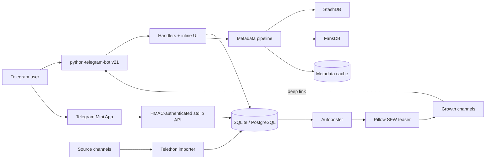

<p align="center">
  
</p>

<h1 align="center">NoDick</h1>

<p align="center">
  <strong>A fast, private and dangerously polished adult media discovery bot for Telegram.</strong>
</p>

<p align="center">
  Instant streaming · intelligent metadata · silent channel indexing · built-in growth loops
</p>

<p align="center">
  <a href="https://t.me/Moyechan_bot"></a>
  <a href="#-quick-start"></a>
</p>

<p align="center">
  
  
  
  
  
  
</p>

> [!IMPORTANT]
> **Adults only.** This project indexes media you already control or are authorized to access. Operators are responsible for consent, copyright, Telegram policy and local law.

---

## 🖤 Not another file-forwarding bot

NoDick turns a Telegram channel into a searchable, enriched streaming library. It silently indexes videos, cleans chaotic filenames, matches scenes against metadata providers and delivers everything through a compact inline-button interface.

No browser pop-ups. No clumsy message dumps. No archaeological expedition through twelve thousand channel posts.

<table>
<tr>
<td width="33%" valign="top">

### ⚡ Instant discovery

Search, categories, performers, recommendations, random picks and favorites—all inside Telegram.

</td>
<td width="33%" valign="top">

### 🧠 Smart metadata

StashDB/FansDB enrichment, fuzzy title matching, phonetic performer matching and confidence controls.

</td>
<td width="33%" valign="top">

### 📈 Growth built in

Autopost teasers, referrals, streaks, Premium milestones, viral video links and welcome A/B tests.

</td>
</tr>
</table>

---

## ✨ The experience

```text
Channel library
      │
      ▼
Silent Telethon scan ──► title cleanup ──► metadata matching
                                              │
                                              ▼
Telegram UI ◄── search / random / cast / similar / categories
      │
      ├──► favorites + watch streaks
      ├──► share exact video with referral attribution
      └──► blurred channel teasers bring the next user in
```

### Discovery

- **🎲 Surprise Me** — one-tap random playback with quota visibility.
- **🔍 Search** — clean title search across the indexed library.
- **📁 Categories** — browse organized studios and content groups.
- **🎭 Performer discovery** — search performers and open cached filmographies.
- **🎯 More Like This** — recommendations powered by cached cast and tags.
- **⭐ Favorites** — personal saves without polluting the source channel.
- **🧩 Multipart navigation** — correctly ordered previous/next controls.

### Intelligence

- **StashDB + FansDB GraphQL** metadata enrichment.
- **RapidFuzz** similarity scoring and **Jellyfish** phonetic matching.
- Configurable match threshold from permissive to perfectionist.
- Cache-first captions for fast repeat views and fewer API calls.
- Corrected titles, performers and studios take priority over external metadata.
- Graceful local-title fallback when metadata services are unavailable.

### Growth engine

- **🚀 Multi-channel autoposter** with cooldowns and repeat avoidance.
- **🫥 SFW teaser generation** using heavily blurred source artwork or thumbnails.
- **🎁 Invite & Earn** credits only activated referrals after their first successful delivery.
- **👑 Premium milestones** — every ten activated referrals grants 30 days.
- **🔥 Watch streaks** with escalating daily quota bonuses.
- **📤 Viral video sharing** — shared links open the exact video and attribute new users.
- **🧪 Welcome A/B tests** measuring real exposure-to-first-watch conversion.
- **📊 Referral social proof** with daily activity and anonymized leaderboard pressure.
- **📈 Durable funnel analytics** for acquisition source, join-gate outcomes, first delivery, DAU/WAU and eligible D1/D7 cohorts.
- **◼ Telegram Mini App** with a personal quota/streak/referral dashboard, text-only catalog, search, categories and saved items.

### Operations

- SQLite locally; PostgreSQL in production.
- Docker and Render-ready deployment.
- Runtime admin settings stored in the database.
- Configurable force-join channels, auto-delete timers, ads, payment copy and QR.
- Fail-closed force-join validation, correct restricted-member handling and a redacted live health check for admins.
- Restart, uptime, new-user, referral and Premium event logging.
- Flood-control retries for Telegram channel copies.
- Atomic quota reservations with automatic refunds when delivery fails.
- Indexed browse/referral paths and non-blocking poster image processing.
- Resumable channel scans with persisted progress and bounded network retries.

---

## 🎮 Commands

### Everyone

| Command | What it does |
|---|---|
| `/start` | Open the main interface |
| `/random` | Play a surprise video |
| `/search <query>` | Search the indexed library |
| `/categories` | Browse by category |
| `/favorites` | Open saved videos |
| `/performer <name>` | Find a performer |
| `/mystats` | View quota, referrals and streak |
| `/refer` | Open the referral dashboard |
| `/premium` | View Premium access |

### Admin

| Command | What it does |
|---|---|
| `/stats` | Library, user and A/B conversion analytics |
| `/settings` | Inline administration dashboard |
| `/import_scan <channel> <message_id>` | Silent bot-token channel scan |
| `/import <channel>` | Full Telethon session import |
| `/import_status` | Current import progress |
| `/threshold <0-100>` | Metadata confidence threshold |
| `/broadcast <message>` | Send an announcement to users |

**Autopost status:** Settings shows an explicit **Auto-Post: ON/OFF** label. Open **Auto-Post Status** for scheduler availability/running state, destination count, remaining cooldown, last successful post, last check/result, and next scheduled check. Enabling queues an immediate cooldown-aware check; later checks remain hourly (default cooldown: six hours). **Post Now** bypasses cooldown and works even when automatic posting is OFF. Manual and scheduled runs share a lock to prevent overlap. Failed attempts, missing channels, missing eligible metadata/videos, and unavailable thumbnail sources receive distinct persisted results instead of a generic failure message. Render Free sleep pauses in-process scheduling; an ON setting alone does not establish an awake service or successful posting.

**Autopost format:** Draft 1 uses a bold title, available Featuring/Studio/Category lines, and an HTML footer quote block. Missing metadata is omitted; no synopsis is invented. The first button row opens Premium and How to Watch; the full-width Open Video button resumes the exact selected video, including after force-join verification. HTML values are escaped and caption fields are bounded for Telegram's caption limit.

**Autopost thumbnails:** The pinned NudeNet 3.4.2 bundled 320n model runs locally on CPU in a one-shot subprocess, with single-threaded ONNX/OpenCV settings, one inference at a time, and a 20-second deadline. Qualified sensitive-region boxes receive padded censorship before resizing. **Settings → Thumbnail Style** offers Pixelation (default), Blur, Solid, or Custom PNG, with Low/Medium/High strength for blur and pixelation. Upload custom PNGs as documents (up to 512 KiB, at most 1024×1024 and one million pixels); normalized overlay data is stored in `bot_settings` rather than Render's ephemeral filesystem. Overlays are placed on an opaque backing so transparency cannot expose the source. Style, strength, and overlay changes invalidate the rendered-thumbnail cache and affect new posts, not already published images. Blur and pixelation are visual concealment, not a guarantee of privacy or platform compliance. No qualified sensitive detections, malformed input, or detection failure produces a source-free branded card—not the original image. This conservative fallback does not make detection infallible: missed regions can remain even when other regions were found. Evaluate real deployment output before relying on selective masking. Illustrated images require separate validation. Outputs have a small in-memory cache, lost on restart.

Render Free currently provides 512 MB RAM shared by the bot and inference process. The model is bundled at install time rather than downloaded at runtime. A local ARM64/Python 3.14 geometric-image smoke test measured a 102,856 KiB peak worker RSS and 0.394 s end-to-end process time; these are not Render measurements or nudity-detection accuracy results. Render uses Python 3.11 from the Dockerfile and may have different resource use and timing. Watch runtime logs and Render memory metrics after deploying. An instance-wide OOM can still kill the bot; subprocess isolation and a timeout cannot guarantee protection from a shared RAM limit. Free web-service idle spin-down can also pause scheduled autoposting.

Most recurring configuration lives in the inline **⚙️ Settings** dashboard. Slash-command archaeology is kept to a minimum because this is software, not a ritual.

**Welcome banner:** Open **Settings → Welcome Media**, then send a photo, GIF, MP4, or a direct `.jpg`/`.png`/`.webp`/`.gif`/`.mp4` URL. Uploads (including forwarded media) are captured before library import handlers. The bot previews the media through Telegram before saving it; invalid input retains the previous banner. Send `clear` to disable the banner or `/cancel` to leave it unchanged. The typed `welcome_media` bot setting persists across restarts and supersedes the old `welcome_gif` setting. Until overridden, the banner uses `https://files.catbox.moe/j9r0xf.jpg`. `/start`, the main-menu return, and successful force-join verification share the same renderer, with a text-menu fallback if the media cannot load. GIF website pages are not direct media URLs; download the file and upload it to the bot instead.

---

## Sponsored 1-Day Premium passes

Optional user flow: **Get 1-Day Premium → Open Sponsor Link → provider destination → return to this bot → 24-hour Premium pass**. The return credential expires after **30 minutes**, is bound to the requesting Telegram account, stored as a SHA-256 hash, and can redeem only once. Only a successfully generated and persisted short link can activate its token. Pending valid links are reused instead of repeatedly calling the provider. A sponsored pass does not overwrite or shorten paid/lifetime Premium; it does not stack while an existing pass remains active. Premium access now suppresses sponsored chat ads and auto-delete warnings/timers for newly delivered videos, for paid and sponsored users alike. Keep a persistent PostgreSQL database on Render—ephemeral SQLite cannot preserve redemption state across deployments.

Set these in the Render service's **Environment**, then redeploy:

```dotenv
SHORTENER_DOMAIN=your-provider.com
SHORTENER_API_KEY=
```

Enter your provider's new key in Render, not in this example or in chat. The feature stays unavailable without a domain and key. It uses a common **AdLinkFly-compatible** HTTPS GET API: `/api?api=<key>&url=<destination>` returning JSON `{"status":"success","shortenedUrl":"https://your-provider.com/example"}`. This is **not universal shortener support**. For compatible variants, configure `SHORTENER_API_PATH`, `SHORTENER_API_PARAM`, `SHORTENER_URL_PARAM`, or dotted `SHORTENER_URL_FIELD` (for example `data.url`). `SHORTENER_LINK_DOMAINS` is a comma-separated exact allowlist when returned short links use a different domain. Providers using POST, bearer authentication, or another workflow need a separate adapter.

**Settings → Sponsor Pass** provides an operator toggle and tutorial upload/reset. `SHORTENER_ENABLED=false` disables the feature at environment level. The Tutorial button includes a bundled 24-second **general workflow** video, not a recording of any specific provider. Upload your own guide as a **Telegram video (not a file/document)** from Settings to replace it; the bot previews delivery before saving. Alternatively, set `SHORTENER_TUTORIAL_VIDEO` to a Telegram video file ID / direct MP4 URL. Follow the panel's clear/reset action to return to the configured or bundled default. Regenerate the included video with `python scripts/generate_shortener_tutorial.py` (Pillow and ffmpeg required for generation, not for serving the video).

**Verification boundary:** this validates a user-bound return token, **not** a provider-signed advertisement completion or payable view. Destination extraction/bypass remains possible; do not promise verified ad impressions, bypass-proof monetization, or guaranteed revenue. Use a provider that explicitly permits both your destination content and incentivized traffic. ShrinkMe's published terms prohibit incentives and adult destinations; merely configuring it does not waive those rules. API credentials belong only in environment configuration. Request failures are sanitized; API redirects and unexpected returned-link hosts are rejected. Async HTTP requests have a 15-second overall deadline covering queueing, DNS, and response streaming; timeout closes the response/client instead of abandoning a blocking network thread. No live provider integration is verified until a permitted provider and fresh credentials are configured and tested.

## 🧬 Architecture



<details>
<summary><strong>Repository map</strong></summary>

```text
NoDick/
├── nodick/
│   ├── __main__.py              # CLI entry point
│   ├── config.py                # Environment-backed settings
│   ├── db.py                    # SQLite/PostgreSQL schema + data layer
│   ├── web.py                   # Health server + Mini App auth/API
│   ├── webapp/                  # Mobile-first HTML/CSS/JS assets
│   ├── utils.py                 # Titles, categories and formatting
│   ├── telegram/
│   │   ├── app.py               # Commands, callbacks and jobs
│   │   └── keyboards.py         # Inline interface layouts
│   ├── metadata/
│   │   ├── stash.py             # StashDB/FansDB GraphQL
│   │   ├── matching.py          # Fuzzy + phonetic matching
│   │   ├── performer_db.py      # Performer cache
│   │   └── rename.py            # Rename suggestions
│   ├── services/
│   │   ├── importer.py          # Full Telethon history import
│   │   ├── message_importer.py  # Silent bot-token scanner
│   │   ├── poster.py            # Blurred teaser autoposter
│   │   └── session.py           # Telegram session login
│   ├── backfill_metadata.py
│   └── backfill_sizes.py
├── .dockerignore                 # Excludes secrets, sessions and local state
├── Dockerfile
├── render.yaml                   # Secret values supplied by Render dashboard
└── requirements.txt
```

</details>

---

## 🚀 Quick start

### Requirements

- Python **3.10+**
- A Telegram bot token from [@BotFather](https://t.me/BotFather)
- Telegram API credentials from [my.telegram.org](https://my.telegram.org) for full-history imports
- Optional StashDB/FansDB credentials for enriched metadata

### Install

```bash
git clone https://github.com/Therazerhub/NoDick.git
cd NoDick

python3 -m venv .venv
source .venv/bin/activate
pip install -r requirements.txt

cp .env.example .env
python -m nodick init-db
python -m nodick run
```

### Minimum configuration

```dotenv
BOT_TOKEN=your_bot_token
ADMIN_ID=your_telegram_user_id
DB_PATH=runtime/nodick.db
BOT_USERNAME=your_bot_username
```

For a production database, set `DATABASE_URL` to a PostgreSQL connection string in your deployment dashboard. **Never commit tokens, database credentials or `.env` files.**

No public web interface is required. The process only serves a `/` health endpoint (`NoDick is alive`) for Render's health checks; all user interaction happens inside Telegram.

<details>
<summary><strong>Optional integrations</strong></summary>

```dotenv
# Full channel-history imports
TELEGRAM_API_ID=123456
TELEGRAM_API_HASH=your_api_hash
TELEGRAM_PHONE=+10000000000
TELEGRAM_USER_SESSION=runtime/nodick_user
IMPORT_CHANNEL_ID=-1001234567890

# Metadata
STASHDB_API_KEY=your_stashdb_api_key
STASHDB_GRAPHQL_URL=https://stashdb.org/graphql
FANSDB_API_KEY=
FANSDB_GRAPHQL_URL=https://fansdb.cc/graphql

# Matching and diagnostics
MATCH_THRESHOLD=0.80
AUTO_RENAME_THRESHOLD=0.90
DEBUG_MATCHING=false
LOG_LEVEL=INFO
LOGS_CHANNEL_ID=0
```

</details>

---

## 📥 Importing a library

### Silent bot-token scan

Forward the latest source-channel video to the bot once, then use the **🛰 Import** button. The stored channel and resume position make future scans one tap.

Power-user equivalent:

```text
/import_scan -1001234567890 10542
```

### Full Telethon history

```bash
python -m nodick session-login
python -m nodick import -1001234567890
```

The in-bot `/import` command is also available after the session has been configured.

---

## 🌐 Metadata matching

```text
/threshold 0     → accept everything
/threshold 80    → strong matches only
/threshold 100   → exacting, merciless perfection
```

Without an API key, playback and local title parsing continue to work. Metadata enhancement is optional; the bot does not collapse dramatically onto a velvet chaise longue when StashDB is unavailable.

---

## 🐳 Docker

```bash
docker build -t nodick .
docker run --env-file .env -p 10000:10000 nodick
```

The container starts the Telegram bot and exposes its health server through the platform-provided `PORT` value.

---

## 🔐 Security

- Keep `BOT_TOKEN`, API keys, session files and database URLs out of Git.
- Configure production secrets through the Render dashboard or your hosting platform.
- Restrict bot administration and library indexing to the configured owner and explicitly granted admins.
- `render.yaml` declares secrets with `sync: false`; supply values only in the Render dashboard.
- `.dockerignore` prevents local databases, sessions, virtualenvs and `.env` files from entering images.
- Use only channels and media you are authorized to index.
- Rotate credentials immediately if they are ever exposed.

---

## 🛠 Built with

<p align="center">
  <a href="https://python.org">Python</a> ·
  <a href="https://python-telegram-bot.org">python-telegram-bot</a> ·
  <a href="https://telethon.dev">Telethon</a> ·
  <a href="https://stashdb.org">StashDB</a> ·
  <a href="https://www.postgresql.org">PostgreSQL</a> ·
  <a href="https://pillow.readthedocs.io">Pillow</a> ·
  <a href="https://render.com">Render</a>
</p>

---

<p align="center">
  <strong>Designed and engineered by <a href="https://github.com/Therazerhub">Razer</a>.</strong>
  <br />
  <sub>Fast when it matters. Polished where everyone else gets lazy.</sub>
</p>
